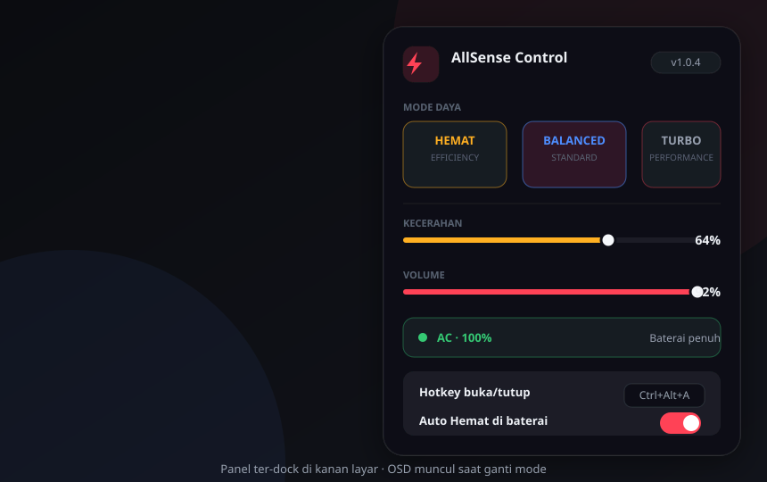

<div align="center">

# ⚡ AllSense Control

**Kendalikan daya laptopmu dalam satu panel — tanpa admin, tanpa driver vendor.**

&nbsp;
&nbsp;
&nbsp;
&nbsp;


<br/><br/>



<br/>

[**⬇️ Unduh `AllSense.setup.exe`**](https://github.com/Maxodus126/AllSense-Control/releases/latest/download/AllSense.setup.exe) &nbsp;·&nbsp; [🌐 Situs](https://maxodus126.github.io/AllSense-Control/) &nbsp;·&nbsp; [📦 Rilis](https://github.com/Maxodus126/AllSense-Control/releases)

</div>

---

**AllSense Control** adalah utility bergaya *gaming laptop* yang menyatukan kontrol **mode daya**, **kecerahan**, **volume**, dan **hotkey global** dalam satu panel kecil yang ter-dock di kanan layar. Berjalan di **Windows 10/11**, **tanpa hak admin**, dan **tanpa driver vendor** — kompatibel lintas merek: ASUS, Lenovo, HP, Acer, Dell, MSI, dan lainnya.

---

## 🚀 Mulai dalam 30 detik

| Langkah | Aksi |
|---|---|
| **1 — Unduh** | klik [`AllSense.setup.exe`](https://github.com/Maxodus126/AllSense-Control/releases/latest/download/AllSense.setup.exe) |
| **2 — Jalankan** | setup → *Install* (satu file, tanpa admin) |
| **3 — Selesai** | ikon ⚡ di tray; panel muncul di kanan layar |

> 💡 Bila Windows menampilkan *Unknown publisher* (belum di-tanda-tangani): **More info → Run anyway**.

### Selalu terbaru
Aplikasi cek rilis terbaru saat mulai → ada versi baru, tombol unduh muncul → **self-update** & restart otomatis. Tanpa uninstall/reinstall.

---

## ✨ Fitur

| ⚙️ | Fitur | Cara kerja (API Windows resmi) |
|---|---|---|
| 🔋 | **Mode daya** — Hemat / Seimbang / Turbo | `PowerSetUserConfigured{AC,DC}PowerMode` + fallback `PowerSetActiveScheme` |
| 🌞 | **Kecerahan** | WMI `WmiSetBrightness` + fallback DDC/CI (dxva2) |
| 🔊 | **Volume & Mute** | CoreAudio `IAudioEndpointVolume` |
| 📡 | **Status Wi-Fi / Bluetooth** (indikator) | WinRT `Windows.Devices.Radios` |
| ⌨️ | **Hotkey global** (toggle & ganti mode) | `user32::RegisterHotKey` |
| 🧊 | **System tray** | WinForms `NotifyIcon` |
| 🔄 | **Self-update otomatis** | GitHub Releases API |
| 🔌 | **Auto power mode** (baterai → Hemat) | `GetSystemPowerStatus` |
| 🚨 | **Peringatan baterai rendah** (5–100%) | `GetSystemPowerStatus` |
| 👁 | **OSD animasi** (ROG/Legion style) | WPF overlay |

---

## 📊 Kenapa bukan "bloatware" vendor?

Banyak laptop hadir dengan app vendor (Armoury Crate, Vantage, OMEN, …) yang berat, selalu nongol, dan terkunci ke satu merek. AllSense Control menawarkan **subset penting yang sama** — tapi universal & minimalis.

| | **AllSense Control** | App vendor |
|---|---|---|
| 🌍 Kompatibilitas | Semua merek | Hanya mereknya |
| ⚖️ Lisensi | Gratis & ringan | Free, tapi berat |
| 🚫 Admin | Tidak perlu | Sering perlu |
| 🧹 Residue | Satu panel kecil | Background service & updater |
| 🔓 Terbuka | Sumber terbuka | Tertutup |
| 🔄 Update | Otomatis via GitHub | Wajib akun |

---

## ⌨️ Hotkey bawaan

| Kombinasi | Aksi |
|---|---|
| `Ctrl + Alt + A` | Buka / sembunyikan panel |
| `Ctrl + Alt + M` | Ganti mode daya |
| *kustom* | rekam kombinasi sendiri di Settings |

> Bentrok dengan aplikasi lain? Otomatis fallback ke kombinasi cadangan.

---

## 🔬 Kenapa bisa "universal"?

Filosofi: **hanya API Windows resmi** — tanpa hook ACPI vendor, tanpa driver, tanpa UAC.

| Kemampuan | API | Tanpa admin |
|---|---|---|
| Mode daya | `powrprof.dll` | ✅ |
| Kecerahan | WMI `root\wmi` / `dxva2.dll` | ✅ |
| Volume | CoreAudio | ✅ |
| Hotkey | `user32` | ✅ |
| Status baterai | `kernel32` | ✅ |
| Update | GitHub API | ✅ |

Yang vendor-specific (fan curve, GPU mux, undervolt, RGB) sengaja **tidak** disentuh — itu yang membuatnya jalan di mana saja.

---

## 🖥️ Tampilan

| Pratinjau | Demo interaktif |
|---|---|
| [preview-panel.svg](docs/preview-panel.svg) | [app-demo.html](docs/app-demo.html) |
| [Situs produk](https://maxodus126.github.io/AllSense-Control/) | — |

OSD `HEMAT` / `BALANCED` / `TURBO` muncul tiap pergantian mode daya.

---

## 🛠️ Membangun dari sumber

```bash
# Prasyarat: .NET 10 SDK
dotnet publish app/AllSense.App/AllSense.App.csproj -c Release
# -> bin/Release/.../win-x64/publish/AllSense.exe

dotnet publish app/Installer/Installer.csproj -c Release -o publish/installer
# -> AllSenseSetup.exe (payload AllSense.exe tertanam)
```

**Struktur repo**

```
app/
├─ AllSense.App/          # aplikasi utama (WPF + WinForms tray)
└─ Installer/             # installer WPF — payload tertanam (self-contained)
.github/workflows/
├─ build.yml              # CI: build + publish single-file
├─ release.yml            # rilis otomatis saat tag v* (setup.exe + AllSense.exe)
└─ pages.yml              # deploy situs (docs/) ke GitHub Pages
docs/                     # situs produk
README.md                 # kamu di sini 👀
```

### 🤖 Rilis otomatis
Tag `v*` → GitHub Actions membangun dan mengunggah **`AllSense.setup.exe`** + **`AllSense.exe`** ke Release. Situs otomatis menunjuk ke `releases/latest` — tanpa sentuh HTML.

---

## 🗺️ Roadmap

- [x] Mode daya AC/DC
- [x] Self-update otomatis
- [x] Ikon tertanam + installer self-contained
- [x] Fallback kecerahan DDC/CI
- [ ] Code signing (hilangkan peringatan SmartScreen)
- [ ] Opsi mulai-minimized
- [ ] UI bilingual (EN/ID)
- [ ] Sertifikat / verifikasi update

---

## ❓ FAQ

**Apakah butuh admin?**
Tidak. Install & berjalan di mode user biasa (`asInvoker`).

**Kenapa kecerahan tak bisa diubah di laptop saya?**
Sebagian besar laptop mendukung; bila vendor memonopoli backlight, WMI/DDC bisa terblokir — slide nonaktif, aplikasi tetap normal.

**Apakah aman?**
Hanya memakai API Windows standar; tidak mengumpulkan data pribadi.

**Bagaimana cara update?**
Otomatis lewat GitHub Releases — cukup klik "Unduh & Terapkan" saat ada versi baru.

---

## 🤝 Kontribusi

PR & issue disambut. Pastikan `dotnet build` lolos dan diuji pada laptop berbasis GPU berbeda.

## ⚖️ Lisensi & Disclaimer

Didesain oleh **Maxodus**. Disediakan *"sebagaimana adanya"* tanpa jaminan; pemakaian menanggung risiko sendiri. Tidak mengumpulkan data pribadi.
