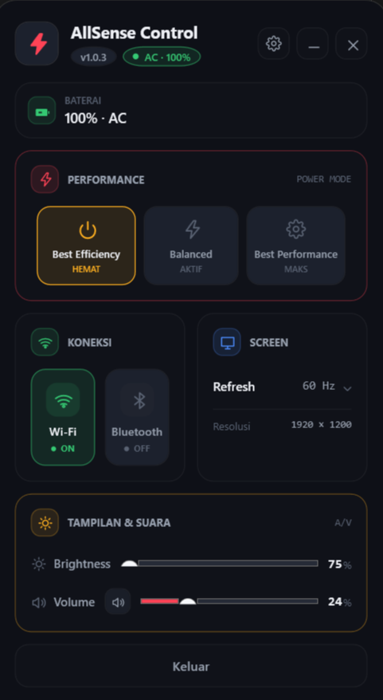

<div align="center">

# ⚡ AllSense Control

**Satu panel kecil untuk kendalikan daya laptopmu — tanpa admin, tanpa driver vendor.**

Kecerahan · Volume · Mode daya · Hotkey global · Self-update otomatis

<br>

<!-- Badges -->
<p>
  <a href="https://github.com/Maxodus126/AllSense-Control/releases/latest">
    
  </a>
  <a href="https://github.com/Maxodus126/AllSense-Control/actions/workflows/build.yml">
    
  </a>
  <a href="https://github.com/Maxodus126/AllSense-Control/issues">
    
  </a>
  <a href="https://github.com/Maxodus126/AllSense-Control/stargazers">
    
  </a>
  
  
</p>

<br>



<br>

[**⬇️ Unduh `AllSense.setup.exe`**](https://github.com/Maxodus126/AllSense-Control/releases/latest/download/AllSense.setup.exe) 
&nbsp; · &nbsp; [🌐 Situs produk](https://maxodus126.github.io/AllSense-Control/)
&nbsp; · &nbsp; [📦 Semua rilis](https://github.com/Maxodus126/AllSense-Control/releases)

</div>

---

## 📑 Daftar Isi

- [Kenapa AllSense Control?](#kenapa-allsense-control)
- [✨ Fitur](#fitur)
- [🚀 Mulai dalam 30 detik](#mulai-dalam-30-detik)
- [🖥️ Tampilan](#tampilan)
- [🔬 Kenapa "universal"?](#kenapa-universal)
- [📊 vs. bloatware vendor](#vs-bloatware-vendor)
- [⌨️ Hotkey bawaan](#hotkey-bawaan)
- [🛠️ Membangun dari sumber](#membangun-dari-sumber)
- [🗺️ Roadmap](#roadmap)
- [❓ FAQ](#faq)
- [🤝 Kontribusi](#kontribusi)

---

## Kenapa AllSense Control?

Aplikasi bawaan laptop (Armoury Crate, Vantage, OMEN, …) di **berat**, **selalu nongol**, dan **terkunci ke satu merek**. AllSense Control mengambil *subset paling penting* dari itu — tapi dibuat **universal**, **ringan**, dan **terbuka**.

| | **AllSense Control** | App vendor |
|---|---|---|
| 🌍 Kompatibilitas | Semua merek laptop | Hanya mereknya |
| ⚖️ Lisensi | Gratis & sumber terbuka | Free, tapi tertutup |
| 🚫 Admin | Tidak perlu | Sering perlu |
| 🧹 Residue | Satu panel kecil | Background service & updater |
| 🔄 Update | Otomatis via GitHub | Wajib akun |

---

## Fitur

| ⚙️ | Fitur | Cara kerja (API Windows resmi) |
|---|---|---|
| 🔋 | **Mode daya** — Hemat / Seimbang / Turbo | `PowerSetUserConfigured{AC,DC}PowerMode` + fallback `PowerSetActiveScheme` |
| 🌞 | **Kecerahan** | WMI `WmiSetBrightness` + fallback DDC/CI (dxva2) |
| 🔊 | **Volume & Mute** | CoreAudio `IAudioEndpointVolume` |
| 📡 | **Status Wi-Fi / Bluetooth** (indikator) | WinRT `Windows.Devices.Radios` |
| ⌨️ | **Hotkey global** (toggle & ganti mode) | `user32::RegisterHotKey` |
| 🧊 | **System tray** | WinForms `NotifyIcon` |
| 🔄 | **Self-update otomatis** | GitHub Releases API |
| 🔌 | **Auto power mode** (baterai → Hemat) | `GetSystemPowerStatus` |
| 🚨 | **Peringatan baterai rendah** (5–100%) | `GetSystemPowerStatus` |
| 👁 | **OSD animasi** (ROG/Legion style) | WPF overlay |

---

## Mulai dalam 30 detik

| Langkah | Aksi |
|---|---|
| **1 — Unduh** | klik [`AllSense.setup.exe`](https://github.com/Maxodus126/AllSense-Control/releases/latest/download/AllSense.setup.exe) |
| **2 — Jalankan** | setup → **Install** (satu file, tanpa admin) |
| **3 — Selesai** | ikon ⚡ di tray; panel muncul di kanan layar |

> 💡 Bila Windows menampilkan *Unknown publisher* (belum di-tanda-tangani): **More info → Run anyway**.

### Selalu terbaru
Aplikasi cek rilis terbaru saat mulai → ada versi baru, tombol unduh muncul → **self-update** & restart otomatis. Tanpa uninstall/reinstall.

---

## Tampilan

| Pratinjau | Demo interaktif |
|---|---|
|  | [app-demo.html](docs/app-demo.html) |
| [Situs produk](https://maxodus126.github.io/AllSense-Control/) | — |

OSD `HEMAT` / `BALANCED` / `TURBO` muncul tiap pergantian mode daya.

---

## Kenapa universal?

Filosofi: **hanya API Windows resmi** — tanpa hook ACPI vendor, tanpa driver, tanpa UAC.

| Kemampuan | API | Tanpa admin |
|---|---|---|
| Mode daya | `powrprof.dll` | ✅ |
| Kecerahan | WMI `root\wmi` / `dxva2.dll` | ✅ |
| Volume | CoreAudio | ✅ |
| Hotkey | `user32` | ✅ |
| Status baterai | `kernel32` | ✅ |
| Update | GitHub API | ✅ |

Yang vendor-specific (fan curve, GPU mux, undervolt, RGB) sengaja **tidak** disentuh — itulah yang membuatnya jalan di mana saja.

---

## Hotkey bawaan

| Kombinasi | Aksi |
|---|---|
| `Ctrl + Alt + A` | Buka / sembunyikan panel |
| `Ctrl + Alt + M` | Ganti mode daya |
| *kustom* | rekam kombinasi sendiri di Settings |

> Bentrok dengan aplikasi lain? Otomatis fallback ke kombinasi cadangan.

---

## Membangun dari sumber

**Prasyarat:** .NET 10 SDK ([unduh](https://dotnet.microsoft.com/download)).

```bash
# Aplikasi utama → bin/Release/.../win-x64/publish/AllSense.exe
dotnet publish app/AllSense.App/AllSense.App.csproj -c Release

# Installer self-contained (payload AllSense.exe tertanam) → AllSenseSetup.exe
dotnet publish app/Installer/Installer.csproj -c Release -o publish/installer
```

**Struktur repo**

```
app/
├─ AllSense.App/          # aplikasi utama (WPF + WinForms tray)
└─ Installer/             # installer WPF — payload tertanam (self-contained)
.github/workflows/
├─ build.yml              # CI: build + publish single-file
├─ release.yml            # rilis otomatis saat tag v* (setup.exe + AllSense.exe)
└─ pages.yml              # deploy situs (docs/) ke GitHub Pages
docs/                     # situs produk
README.md                 # kamu di sini 👀
```

### 🤖 Rilis otomatis
Tag `v*` → GitHub Actions membangun dan mengunggah **`AllSense.setup.exe`** + **`AllSense.exe`** ke Release. Situs otomatis menunjuk ke `releases/latest` — tanpa sentuh HTML.

---

## Roadmap

- [x] Mode daya AC/DC
- [x] Self-update otomatis
- [x] Ikon tertanam + installer self-contained
- [x] Fallback kecerahan DDC/CI
- [ ] Code signing (hilangkan peringatan SmartScreen)
- [ ] Opsi mulai-minimized
- [ ] UI bilingual (EN/ID)
- [ ] Sertifikat / verifikasi update

---

## FAQ

<details open>
<summary><b>Apakah butuh admin?</b></summary>

Tidak. Install & berjalan di mode user biasa (`asInvoker`).
</details>

<details open>
<summary><b>Kenapa kecerahan tak bisa diubah di laptop saya?</b></summary>

Sebagian besar laptop mendukung; bila vendor memonopoli backlight, WMI/DDC bisa terblokir — slide nonaktif, aplikasi tetap normal.
</details>

<details open>
<summary><b>Apakah aman?</b></summary>

Hanya memakai API Windows standar; tidak mengumpulkan data pribadi.
</details>

<details open>
<summary><b>Bagaimana cara update?</b></summary>

Otomatis lewat GitHub Releases — cukup klik "Unduh & Terapkan" saat ada versi baru.
</details>

---

## Kontribusi

PR & issue disambut. Pastikan `dotnet build` lolos dan diuji pada laptop berbasis GPU berbeda.

## ⚖️ Lisensi & Disclaimer

Didesain oleh **Maxodus**. Disediakan *"sebagaimana adanya"* tanpa jaminan; pemakaian menanggung risiko sendiri. Tidak mengumpulkan data pribadi.
